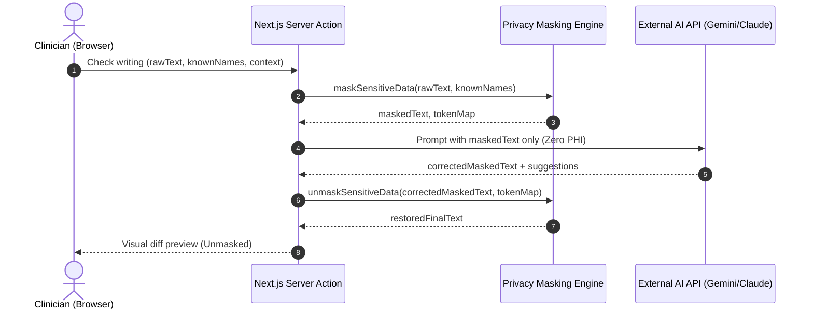

# Writing Assistant & Mobile Ergonomics Specification

Guild Club Services includes a built-in, privacy-preserving **Writing Assistant** and universal clinical text entry enhancements designed for desktop, tablet, and mobile touch devices.

---

## 1. Overview & Core Philosophy

Clinical records, progress notes, and diagnostic observations demand precision and professionalism without compromising patient confidentiality.

Key design guarantees:
1. **Zero Automatic Alterations**: AI text suggestions are never applied automatically. Users must explicitly click **"Use corrected text"** or check individual recommendations.
2. **On-Demand Only**: No network requests occur while typing. The assistant activates only when the user explicitly triggers **"Check writing"**.
3. **Zero Clinical Data Leakage (De-identification First)**: All Personally Identifiable Information (PII) and Protected Health Information (PHI) are scrubbed before sending payloads to external AI model endpoints.
4. **Zero Persistent Storage**: Neither user-provided draft text nor AI-generated suggestions are ever stored in the database, transaction logs, case events, or audit queues.
5. **Fail-Safe Operation**: If the AI model service is slow or times out (10-second limit), a friendly message is shown: *"Writing check is unavailable right now. Your text is safe; try again later."* User draft text is **never lost or overwritten** on failure.

---

## 2. Configuration & Environment Variables

The Writing Assistant is managed via environment variables and is disabled (`off`) by default:

```env
# Provider options: "off" | "gemini" | "anthropic" | "mock"
WRITING_ASSIST_PROVIDER=off

# API key for the chosen provider (Gemini or Anthropic)
WRITING_ASSIST_API_KEY=
```

### Supported Providers:
- **`off` (Default)**: The assistant is entirely inactive. The "Check writing" button is not rendered in the UI; no background checks or SDK initializations occur.
- **`gemini`**: Uses `@google/genai` with `gemini-2.5-flash`. Fast, concise corrections and clinical suggestions.
- **`anthropic`**: Uses `@anthropic-ai/sdk` with `claude-3-5-haiku-latest`. High-fidelity grammatical and stylistic assistance.
- **`mock`**: Deterministic test and offline mode used in staging and Playwright test suites.

---

## 3. Privacy & Sensitive Data Masking

Before text is submitted to any external provider API, `maskSensitiveData()` runs on the server:

| Data Type | Detection Pattern | Mask Token |
| :--- | :--- | :--- |
| **Email Addresses** | `[A-Za-z0-9._%+-]+@[A-Za-z0-9.-]+\.[A-Za-z]{2,}` | `[EMAIL_1]`, `[EMAIL_2]` |
| **Phone Numbers** | `(\+91[\-\s]?)?[6-9]\d{9}` and standard international formats | `[PHONE_1]`, `[PHONE_2]` |
| **Patient Identifiers** | Case references matching `GCP-\d{4}` | `[ID_1]`, `[ID_2]` |
| **Dates of Birth** | `DD/MM/YYYY`, `YYYY-MM-DD`, `DD-MM-YYYY` | `[DOB_1]`, `[DOB_2]` |
| **Known Names** | Client and therapist full/partial names passed in `knownNames` | `[PERSON_1]`, `[PERSON_2]` |

### Scrubbing & Reconstruction Lifecycle:


**Never Transmitted to AI**:
- Branch names, Room numbers, Case IDs, User IDs, Clinician credentials, or Database records.

---

## 4. Rate Limiting & Abuse Prevention

To prevent cost overruns and accidental flooding:
- **Rate Limit**: Maximum **30 checks per user per hour**.
- **Character Bounds**: Minimum **10 characters**, maximum **3,000 characters**.
- **Sanitization**: All output from external providers is sanitized to strip HTML tags, script injections, and Markdown executable code, capped at 4,000 characters.

---

## 5. User Interface & Interaction Design

The `<WritingAssist />` component is integrated across all long-form clinical and administrative fields:
- **Therapist Session Drawer**: Present condition, Session notes.
- **New Case Creation**: Presenting issues, Initial intake notes.
- **Case Closing / Progress Reports**: Current condition, Progress evaluation, Closing summary.
- **Admin Communication**: Therapist notes / Administrative directives.

### Interaction States:
1. **Disabled Button**: When the field has fewer than 10 characters, the button is disabled.
2. **Segmented Mode Picker**:
   - **Fix spelling & grammar** *(Default)*: Smallest possible diff, fixing typos, punctuation, and clinical tense consistency.
   - **Suggest improvements**: Corrected text plus up to 3 actionable suggestions (clarity, missing clinical details, objective tone), each selectable via checkbox.
3. **Difference Display**: Deletions are shown in red with strikethrough (`line-through text-red-700 bg-red-50`); additions are displayed in green (`text-emerald-700 bg-emerald-50 font-medium`).
4. **Auto-Dismiss on Edit**: If the clinician resumes typing in the textarea while the assist panel is open, the panel closes automatically to ensure stale suggestions are never inadvertently applied.

---

## 6. Mobile & Touch Ergonomics

Optimized for mobile viewports (e.g., iPhone 12/13/14 at 390px × 844px) and Android devices:

1. **iOS Auto-Zoom Prevention**:
   - All `<input>` and `<textarea>` elements enforce a base font size of **16px** on small screens (`text-base sm:text-sm`). This prevents Safari on iOS from automatically zooming into inputs on focus.
2. **44px Minimum Touch Targets**:
   - Buttons, tab triggers, modal close triggers, and checkboxes enforce `min-h-[44px]` and `min-w-[44px]` on touch devices (`@media (pointer: coarse)`).
3. **Viewport & Safe Areas**:
   - Fullscreen drawers and overlays use `h-dvh` and `min-h-dvh` (Dynamic Viewport Height) rather than static `100vh` to avoid mobile address bar cutoffs.
   - Safe-area insets (`env(safe-area-inset-top)`, `env(safe-area-inset-bottom)`) are incorporated into headers, floating bars, and footers.
4. **Spellcheck & Semantic Attributes**:
   - `spellCheck={true}` enabled universally on free-text inputs.
   - `lang="en-IN"` configured on Indian clinical text inputs.
   - `autoCapitalize="words"` for person names; `autoCapitalize="sentences"` for general clinical text; `autoCapitalize="none"` for emails and passwords.
   - Appropriate `autoComplete` attributes (`name`, `email`, `tel`, and `off` for clinical/diagnostic fields).

